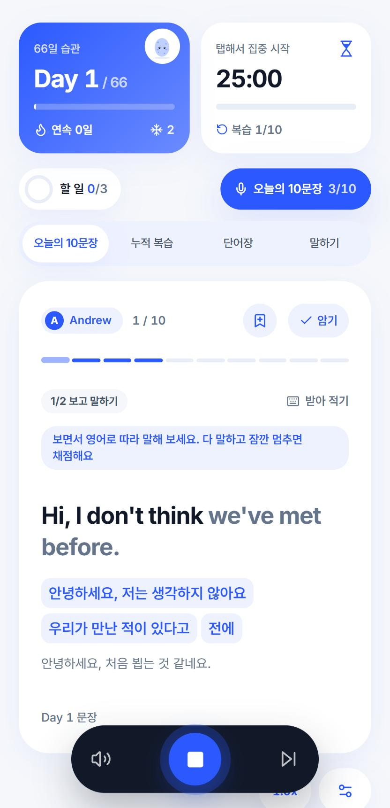
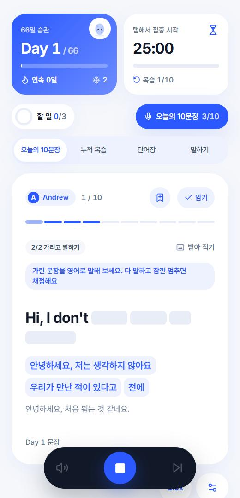
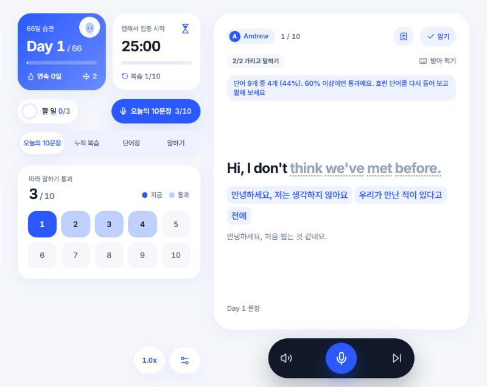
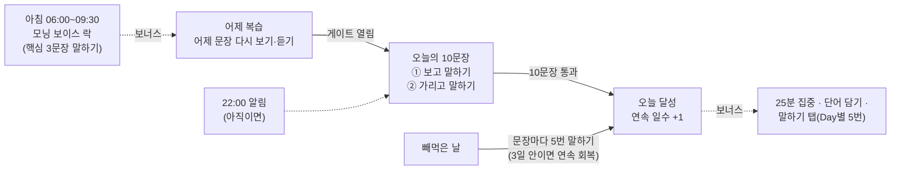

<div align="center">

# 66 Habit English

**영어 어순으로 하루 10문장, 소리 내어 말해야 끝나는 습관 앱**

듣기만 해서는 달성이 아닙니다. 문장마다 보고 말하고, 가리고 다시 말해야 오늘이 채워집니다.<br>
66일은 끝이 아니라 습관이 붙기까지의 한 라운드입니다.


&nbsp;&nbsp;


<sub>왼쪽: 1/2 보고 말하기(말하는 동안 맞힌 단어가 진해짐) · 오른쪽: 2/2 가리고 말하기(맞힌 단어만 드러남)</sub>

</div>

## 어떤 앱인가요

혼자 쓰는 영어 회화 암송 앱입니다. 한 문장을 **영어 원문 · 영어 어순 그대로 끊은 직역 · 자연스러운 해석** 세 줄로 보여 주고, 그 문장을 직접 소리 내어 말하게 합니다. 브라우저 음성 인식으로 순서대로 맞힌 단어를 세어 채점합니다.

Windows PC 한 대가 서버이고, 갤럭시 Z 폴드에서 Tailscale HTTPS 주소로 접속해 홈 화면 앱(PWA)으로 씁니다. 접은 커버 화면과 펼친 화면에 따로 맞춘 레이아웃이 있습니다.

<div align="center">

<br><sub>펼친 화면: 왼쪽은 오늘 통과한 문장 지도, 오른쪽은 말해 본 뒤 맞힌 단어(진하게)와 놓친 단어(흐리게)</sub>
</div>

## 하루 흐름



## 핵심 기능

| 기능 | 내용 |
|---|---|
| **오늘의 10문장 따라 말하기** | 문장마다 ① 영어를 보며 따라 말하고 ② 영어를 가린 채 어순·해석만 보고 다시 말합니다. 순서대로 맞힌 단어가 60% 이상이면 통과하고, 열 문장을 모두 통과해야 오늘이 달성됩니다. 말이 1.8초 끊기면 스스로 채점하고, 소리 내기 어려운 곳에서는 받아 적기(80%)로 바꿀 수 있습니다. |
| **어제 복습 게이트** | 어제 배운 문장을 다시 보거나 들어야 오늘 문장이 열립니다. |
| **핸즈프리 오디오** | 연속 · 끊어 읽기(따라 말할 시간을 줌) · 역할극(B 대사를 비워 둠). 화면이 꺼져도 무음 트랙으로 대기 시간을 지키고, 잠금 화면·버즈 버튼으로 조작합니다. |
| **모닝 보이스 락** | 아침에 처음 열면 핵심 문장 3개를 소리 내어 읽어야 앱이 열립니다. |
| **습관 트래커** | 66일 히트맵, 연속 일수, 30일마다 프리즈 2개. 66일이 지나면 2라운드로 이어지고, 새 레슨이 없는 날은 가장 오래 안 본 레슨을 다시 돌립니다. |
| **빼먹은 날 보충** | 놓친 날의 레슨을 문장마다 5번 말하면 그날이 채워지고, 3일 안이면 연속 일수도 지켜집니다. 미리 "오늘은 어려워요"를 알린 날은 1번으로 충분합니다(30일에 4번). |
| **말하기 탭 · 단어장** | Day별로 문장을 5번씩 말하는 연습, 문장에서 담은 표현의 뜻·느낌·예문을 자동으로 채우는 단어장. |
| **알림 · 자동 실행** | 22시까지 달성하지 못했으면 Web Push(선택적으로 텔레그램·디스코드). 갤럭시 루틴이나 앱 바로가기로 원하는 재생 모드를 바로 시작합니다. |
| **오프라인** | 받아 둔 문장과 음성은 비행기 모드에서도 재생되고, 그동안의 기록은 연결되면 서버로 보냅니다. |
| **자동 백업** | 매일 04:30과 서버가 켜질 때 DB를 사본으로 남기고 최근 14개를 보관합니다. |

## 구조

```
갤럭시 Z 폴드 (PWA, Chrome WebAPK)
        │ https://<PC이름>.<tailnet>.ts.net/   (tailscale serve --bg 8080)
        ▼
Windows PC ─ Spring Boot :8080 (단일 포트)
             ├─ /                → React 화면 (빌드 결과를 정적 파일로)
             ├─ /api/v1/**       → REST API
             ├─ /api/v1/audio/** → edge-tts 로 만든 원어민 MP3 캐시
             └─ ./data/          → SQLite · 음성 · VAPID 키 · 백업
```

| 영역 | 사용 기술 |
|---|---|
| 프런트엔드 | React 18, TypeScript(strict), Vite, Tailwind CSS 3, framer-motion, lucide-react, Web Speech API, Service Worker |
| 백엔드 | Spring Boot 3.4, Java 17+, Gradle, SQLite(WAL), Web Push(VAPID) |
| 음성 | edge-tts(원어민 MP3), 음성 파일이 없으면 기기 음성으로 대신 읽기 |
| 단어 뜻 생성 | Claude(로그인된 Claude Code 또는 API 키, 끌 수 있음) |

### 설계 원칙

- **사실만 저장한다.** 학습 쓰기는 `POST /api/v1/events` 하나뿐이고, 연속 일수·프리즈·게이트 같은 파생값은 저장하지 않고 요청마다 순수 함수로 다시 계산합니다.
- **시간 판단은 서버가 한다.** 논리 날짜(새벽 3시에 하루가 바뀜), Day 번호, 게이트는 서버 계산값을 씁니다. 프런트엔드는 날짜를 직접 계산하지 않습니다.
- **오프라인을 먼저 생각한다.** 기록은 기기 안 대기열에 먼저 남기고 화면에 바로 반영한 뒤 서버로 보냅니다. 같은 기록을 두 번 보내도 한 번만 반영됩니다.
- **단일 포트.** 화면과 API를 한 서버가 같은 주소로 내보내므로, 프런트엔드 코드에는 절대 주소가 없습니다.

## 문서

| 문서 | 내용 |
|---|---|
| [SPEC.md](SPEC.md) | 기능·API 계약(기준 문서) |
| [docs/architecture.md](docs/architecture.md) | 설계 근거 |
| [docs/HANDOVER.md](docs/HANDOVER.md) | 진행 상황과 인수인계 |
| [docs/pc-local-setup.md](docs/pc-local-setup.md) | 서버로 쓰는 PC의 설정과 되돌리는 방법, 백업에서 되살리기 |
| [CLAUDE.md](CLAUDE.md), [clean-blue-ui](.claude/skills/clean-blue-ui/SKILL.md) | 코딩 규칙, 화면 디자인 규칙 |

---

# 설치와 운영

## 1. PC 준비 (한 번만)

| 필요한 것 | 확인 | 설치 |
|---|---|---|
| Java 17 이상 | `java -version` | `winget install EclipseAdoptium.Temurin.21.JDK` |
| Node.js 18 이상 | `node -v` | https://nodejs.org |
| Python 3.10 이상 + edge-tts | `python -m edge_tts --list-voices` | `python -m pip install --user edge-tts` |
| Tailscale | `tailscale status` | https://tailscale.com/download |

`build-all.bat`은 Java가 PATH에 없어도 `C:\Program Files\Eclipse Adoptium` 아래 JDK를 찾아 씁니다.

## 2. 빌드하고 실행하기

```bash
build-all.bat
```

순서대로 프론트엔드 빌드 → `backend/src/main/resources/static`으로 복사 → 백엔드 jar 빌드 → `tailscale serve --bg 8080` → 서버 실행까지 합니다. 처음에는 Gradle 의존성을 받느라 몇 분 걸립니다.

- 빌드만: `build-all.bat norun`
- 다음부터 실행만: `run.bat`
- PC에서 확인: http://localhost:8080

첫 실행 때 자동으로 일어나는 일:
- `data/habit66.db`를 만들고 Day 1~5(50문장)를 넣습니다. 오늘이 Day 1입니다.
- 50문장의 원어민 음성(MP3)을 백그라운드에서 만듭니다. 1~3분 걸리고, 그동안 아직 없는 문장은 폰의 기기 음성으로 대신 읽습니다.
- 알림용 VAPID 키를 `data/vapid.json`에 만듭니다.

## 3. Tailscale로 폰에서 접속하기 (HTTPS)

마이크(모닝 보이스 락), 알림, 화면 꺼짐 방지, 오프라인 캐시는 **HTTPS에서만** 동작합니다. Tailscale이 무료로 HTTPS 주소를 만들어 줍니다.

1. PC와 폰 모두 Tailscale 앱을 설치하고 같은 계정으로 로그인합니다.
2. Tailscale 관리 콘솔(https://login.tailscale.com/admin/dns)에서 **MagicDNS**와 **HTTPS Certificates**를 켭니다.
3. PC에서 한 번 실행합니다(`build-all.bat`·`run.bat`이 자동으로 실행하지만, 처음에는 인증서 발급 확인이 필요할 수 있습니다).

   ```bash
   tailscale serve --bg 8080
   ```

4. 주소를 확인합니다.

   ```bash
   tailscale serve status
   ```

   `https://<PC이름>.<tailnet이름>.ts.net` 형태의 주소가 나옵니다.

끄려면 `tailscale serve reset`.

## 4. 폰에 앱으로 설치하기

1. 폰의 **Chrome**에서 위 HTTPS 주소를 엽니다.
2. 메뉴(⋮) → **앱 설치** 또는 **홈 화면에 추가**를 누릅니다.
3. 홈 화면의 **66 Habit** 아이콘으로 엽니다. 설치된 앱은 Chrome 정책상 자동 재생이 허용되어 루틴 자동 실행이 잘 됩니다.
4. 앱 안 **설정(⚙)** → **마감 알림**을 켜고 알림 권한을 허용합니다. **시험 알림 보내기**로 확인합니다.
5. 모닝 보이스 락을 처음 쓸 때 마이크 권한을 허용합니다.

### 접은 화면과 펼친 화면

- 접은 커버 화면: 한 열(헤더 → 탭 → 학습 카드 → 컨트롤 → 하단 재생 독).
- 펼친 내부 화면(폭 600px 이상): 두 열(왼쪽 헤더·탭·컨트롤, 오른쪽 큰 학습 카드).

## 5. 갤럭시 모드 및 루틴으로 자동 실행

아래 주소로 열면 그 모드로 바로 재생합니다. 어제 복습이 남아 있으면 복습부터 재생하고, 복습이 끝나 오늘 문장이 열리면 이어서 오늘의 10문장을 재생합니다.

| 모드 | 주소 |
|---|---|
| 끊어 읽기 | `https://<내 주소>/?autoplay=true&mode=shadowing` |
| 역할극 | `https://<내 주소>/?autoplay=true&mode=roleplay` |
| 연속 듣기 | `https://<내 주소>/?autoplay=true&mode=full` |

앱 설정 화면의 **갤럭시 루틴 주소**에서 내 주소가 들어간 링크를 바로 복사할 수 있습니다.

연결 방법은 두 가지입니다. 기기·One UI 버전에 따라 메뉴 이름이 다를 수 있습니다.

1. **앱 바로가기**: 홈 화면의 66 Habit 아이콘을 길게 누르면 세 모드 바로가기가 나옵니다(매니페스트 `shortcuts`). 바로가기를 홈 화면으로 끌어 두면 한 번 탭으로 자동 재생됩니다.
2. **모드 및 루틴**: 설정 → 모드 및 루틴 → 루틴 → `+`
   - 조건 예: "시간 07:40, 평일" 또는 "블루투스 기기(Galaxy Buds) 연결됨"
   - 동작: 웹 주소(URL)를 여는 동작이 있으면 위 주소를 넣습니다. 설치된 앱의 범위 안 주소라 Chrome 탭이 아니라 66 Habit 앱으로 열립니다. URL 동작이 보이지 않으면 "앱 열기 → 66 Habit"을 쓰고 재생 버튼을 한 번 누릅니다.

브라우저가 소리 재생을 막으면 화면에 **탭해서 재생 시작** 버튼이 뜹니다.

## 6. 콘텐츠 추가 (Day 6 이후)

레슨 JSON 형식은 [SPEC.md 4.7](SPEC.md)과 예시 [content/day06.json](content/day06.json)을 참고하세요. 한 파일에 여러 일차를 넣어도 됩니다.

서버가 켜진 상태에서:

```bash
python scripts/generate_tts.py --import content/day06.json
```

임포트 → 없는 음성 목록 받기 → edge-tts로 병렬 합성 → 서버에 업로드까지 합니다. 파일 이름·길이 규칙은 서버에만 있어서 스크립트는 서버가 알려 준 대로만 만듭니다.

- 음성만 다시 채우기: `python scripts/generate_tts.py`
- 할 일만 보기: `python scripts/generate_tts.py --dry-run`
- 다른 주소의 서버: `--base-url http://<주소>:8080`

같은 일차·순번을 다시 임포트하면 문장 텍스트만 바뀌고 암기 상태는 유지됩니다. 영어 문장이 바뀌면 그 문장의 음성만 새로 만들어집니다.

## 7. 설정 바꾸기 (알림 웹훅, 관리자 토큰)

프로젝트 루트에 `config/application.yml`을 만들면 `backend/src/main/resources/application.yml`의 값을 덮어씁니다(Spring Boot가 실행 위치의 `config/` 폴더를 자동으로 읽습니다). 이 파일에는 토큰이 들어가므로 저장소에 올리지 마세요(`.gitignore`에 있음).

```yaml
app:
  admin-token: "길고-추측하기-어려운-문자열"     # 비워 두면 관리자 API에 토큰이 필요 없음
  reminder:
    telegram:
      enabled: true
      bot-token: "123456:ABC..."                # @BotFather 에서 발급
      chat-id: "123456789"
    discord:
      enabled: true
      webhook-url: "https://discord.com/api/webhooks/..."
```

관리자 토큰을 넣었다면 스크립트에도 `--admin-token` 또는 환경 변수 `APP_ADMIN_TOKEN`을 주세요. 시작일을 바꾸려면:

```powershell
curl.exe -X PUT http://127.0.0.1:8080/api/v1/admin/settings/start-date -H "X-Admin-Token: $env:APP_ADMIN_TOKEN" -H "Content-Type: application/json" -d '{"start_date":"2026-11-15"}'
```

22시 리마인더는 서버에 도착한 기록 기준으로 판단합니다. PC가 22시 전후에 꺼져 있으면 알림이 가지 않습니다(서버가 22시~03시 사이에 켜지면 한 번 보충합니다).

## 8. 개발

```bash
cd backend && gradlew.bat bootRun
```

```bash
cd frontend && npm run dev
```

- 프론트 개발 서버: http://localhost:5173 (`/api`는 8080으로 프록시)
- 타입 검사: `cd frontend && npm run typecheck`
- 백엔드 테스트: `cd backend && gradlew.bat test`
- `bootRun`은 프로젝트 루트에서 실행되어 `data/`를 운영과 같이 씁니다.

## 9. 실제 폰에서 확인할 것

PC 브라우저로는 확인할 수 없어 갤럭시에서 직접 봐야 하는 항목입니다.

- [ ] 끊어 읽기 재생 중 화면을 꺼도 다음 문장으로 넘어간다(무음 대기가 밀리지 않는다).
- [ ] 잠금 화면 미디어 컨트롤과 버즈 버튼으로 이전 / 재생·일시정지 / 다음이 된다.
- [ ] 버즈를 빼면 재생이 멈추고, 다시 재생을 누르면 대기 중이던 지점부터 이어진다.
- [ ] 비행기 모드에서도 이미 받아 둔 문장은 재생된다(학습 카드 아래 "준비 n/m"이 꽉 찬 뒤).
- [ ] 비행기 모드에서 들은 기록이 연결 후 서버에 올라간다(설정 → 오늘 기록 → 보내지 않은 기록 0건).
- [ ] 06:00~09:30에 처음 열면 모닝 스타터가 뜨고, 소리 내어 읽으면 통과한다.
- [ ] 오늘의 10문장에서 보고 말하기 → 가리고 말하기가 실제 마이크로 통과되고, 말을 잠깐 멈추면 채점된다.
- [ ] 22시 시험 알림이 잠금 화면에 온다.
- [ ] 접은 화면·펼친 화면에서 가로 스크롤 없이 보인다.

## 10. 문제 해결

| 증상 | 확인할 것 |
|---|---|
| 폰에서 "서버에 연결하지 못했어요" | PC 서버가 켜져 있는지, 폰 Tailscale이 연결돼 있는지, `tailscale serve status` |
| 음성이 기기 음성(로봇 목소리)으로 나옴 | 아직 MP3 생성 중이거나 실패. `python scripts/generate_tts.py`로 다시 채우기 |
| 알림 스위치가 회색 | HTTPS 주소로 열었는지, 홈 화면에 설치한 앱인지, 폰 알림 권한 |
| 모닝 락에서 마이크가 안 됨 | Chrome 사이트 설정에서 마이크 허용. 급하면 "긴급 건너뛰기" |
| 한글이 깨진 로그 | `run.bat`이 `chcp 65001`로 UTF-8을 켭니다. 다른 창에서 실행했다면 같은 명령을 먼저 실행 |
